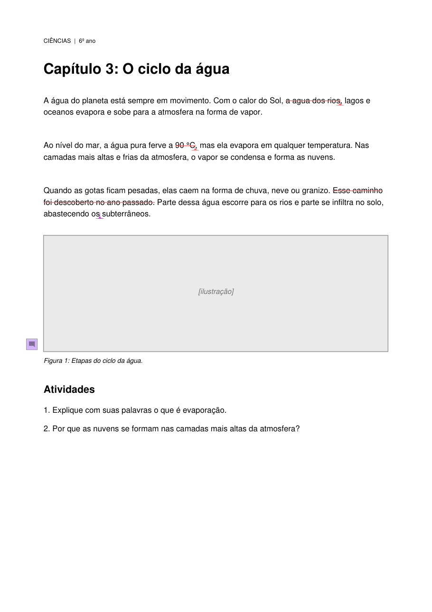

# marcador-pdf

Marcações de revisão em PDF **por código**, gravadas do jeito que o Adobe Acrobat grava:
riscar, substituir, inserir texto e comentar. O resultado abre no painel de Comentários do
Acrobat como se tivesse sido feito à mão, e pode ser editado, respondido e aceito normalmente.



## Para que serve

A revisão de provas de um livro acontece no Acrobat: quem revisa risca, substitui, insere e
comenta, e a diagramação trabalha a partir do painel de Comentários. Quando a lista de
correções já existe em outro lugar (uma planilha, um documento revisado, um cotejo),
refazer tudo à mão no Acrobat custa horas e erra por cansaço.

Esta biblioteca recebe a lista e escreve as anotações direto no arquivo:

```json
[
  {"pagina": 1, "acao": "substituir", "trecho": "90 °C", "novo": "100 °C"},
  {"pagina": 1, "acao": "riscar", "trecho": "Esse caminho foi descoberto no ano passado."},
  {"pagina": 1, "acao": "inserir", "trecho": "abastecendo os", "texto": "lençóis"},
  {"pagina": 1, "acao": "comentar", "trecho": "Figura 1", "texto": "Iconografia: trocar a ilustração."},
  {"pagina": 2, "acao": "excluir_pagina", "texto": "Diagramação: excluir esta página."}
]
```

```bash
marcador-pdf marcar prova.pdf correcoes.json -o prova_marcada.pdf --autor "Revisão"
```

## Por que não basta `add_strikeout_annot`

As bibliotecas de PDF criam anotações válidas pela especificação, mas o Acrobat as trata
como estrangeiras: sem data no painel, sem janela de nota, com a substituição aparecendo
como dois comentários soltos e o sinal de inserção com quase o triplo do tamanho.

Aqui, cada tipo de marcação foi feito à mão no Acrobat 26.2 (pt-BR), o dicionário PDF que
ele gravou foi lido e o código foi ajustado até as divergências zerarem. Alguns achados:

- **Substituir é um par**, não uma anotação: um `Caret` com `/IT /Replace` e um `StrikeOut`
  filho ligado por `/IRT` e `/RT /Group`. É o que faz o painel mostrar um item só.
- **O sinal de inserção é uma figura vetorial** de 13 coeficientes, escalada pelo corpo do
  texto e centrada no ponto de inserção.
- **Os rótulos vão em Latin-1 octal** (`Coment\341rio do texto`); em UTF-8 o Acrobat os lê tortos.
- **O PyMuPDF desfaz a geometria** das anotações anteriores a cada anotação nova, então os
  ajustes são agendados e aplicados só na hora de salvar.
- **Salvar com `garbage=3`** funde os arrays `/Annots` vazios, e uma marcação feita depois
  numa página aparece em dezenas de outras.

A tabela completa está em [docs/anatomia-das-anotacoes.md](docs/anatomia-das-anotacoes.md).

## Instalação

```bash
pip install git+https://github.com/Halker11/marcador-pdf
```

Requer Python 3.10 ou mais novo e instala o [PyMuPDF](https://pymupdf.readthedocs.io).

## Uso em Python

```python
from marcador_pdf import Marcador

m = Marcador("prova.pdf", autor="Revisão")

m.riscar(0, "trecho a excluir")
m.substituir(0, "texto antigo", "texto novo")
m.inserir(0, "âncora", "texto a acrescentar")          # antes=True insere antes da âncora
m.comentar(0, "âncora", "Recado para a diagramação.")
m.excluir_pagina(1)                                     # X vermelho nas diagonais

m.salvar("prova_marcada.pdf")
```

Em Python, `pagina` é índice base 0 (como no PyMuPDF); no JSON da linha de comando é o
número da página no PDF, começando em 1.

O trecho é localizado pelo texto da página. Se ele não existir, ou aparecer mais de uma
vez, o método levanta `LookupError`: é melhor falhar do que marcar o lugar errado em
silêncio. Para o que não é um trecho de texto corrido (tabela, balão, página reformulada)
há `riscar_regiao`, `substituir_regiao`, `destacar_regiao` e `comentar_em_ponto`, que
recebem retângulos ou coordenadas.

Marcações que já estão no PDF, de qualquer autor, são preservadas.

## Conferir antes de entregar

```bash
marcador-pdf conferir prova_marcada.pdf --autor "Revisão"
```

Confere campos obrigatórios, `/NM` únicos, pares de substituição agrupados e a geometria do
sinal de inserção. Com `--referencia manual.pdf --autor-ref "Fulano"`, compara campo a campo
com marcações feitas à mão naquele arquivo, que é o teste mais forte.

O que o código **não** confere, e continua dependendo de olho humano:

- **Aparência.** O desenho de cada marcação (`/AP`) é escrito aqui, não pelo Acrobat.
- **Acerto editorial.** Que a marcação certa foi para o lugar certo.

Num livro inteiro, vale gerar primeiro um recorte de poucas páginas e validar no Acrobat.

## Exemplo

A pasta [exemplos/](exemplos) tem uma prova fictícia de duas páginas, a lista de correções
e o PDF marcado. Para gerar tudo de novo:

```bash
python exemplos/gerar_exemplo.py
```

A imagem no topo deste arquivo é a página 1 de `prova_marcada.pdf` desenhada pelo MuPDF.

## Limites

- O PDF precisa ter camada de texto. Arquivo digitalizado precisa de OCR antes.
- Os rótulos (`Riscado`, `Texto digitado`, `Comentário do texto`) e as cores são os do
  Acrobat 26.2 em português do Brasil, a única versão contra a qual foi conferido.
- A escala do sinal de inserção foi medida em texto de 8 pt e é proporcional nos outros corpos.
- A importação dos comentários no InDesign usa o texto do sinal de inserção tal como está,
  então ele deve carregar só o que entra no livro. Recados vão em comentário separado.

## Desenvolvimento

```bash
pip install -e ".[dev]"
```

```bash
pytest
```

## Licença

MIT. O PyMuPDF, do qual este pacote depende, é distribuído sob AGPL ou licença comercial
da Artifex; quem redistribuir os dois juntos precisa observar os termos dele.
